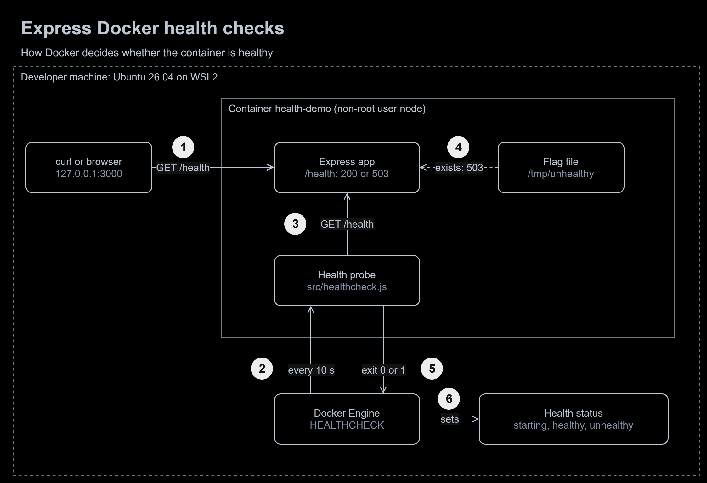

# Express Docker Health Checks


**Type:** Springer Capital Internship Project, local lab | **Status:** complete, verified on 10 November 2026

> **Evaluation project.** A learning task completed for the Springer Capital internship programme. Everything runs locally against a small demo app. It is not a production deployment and contains no company data.

**At a glance**

- **Outcome:** an app that tells Docker honestly whether it can serve requests, so a broken container is marked unhealthy within 30 seconds instead of just showing "Up".
- **Built:** an Express 5 app with a `/health` endpoint, a Node health probe, a Dockerfile with `HEALTHCHECK`, a Jest and Supertest suite, and a recorded verification run.
- **Stack:** Node.js 24, Express 5, Jest, Supertest, Docker Engine 29 (BuildKit), curl, jq, draw.io.
- **Proof:** 5 of 5 tests pass. On 10 November 2026 the container turned healthy 2.7 s after start, unhealthy after 3 failed checks, and healthy again after 1 passing check.



To zoom in, right-click the diagram and open the image in a new tab. The editable source is [`docs/diagrams/health-check-flow.drawio`](docs/diagrams/health-check-flow.drawio).

1. A **client** (curl or a browser) calls `GET /health` on `127.0.0.1:3000`, which Docker maps into the container.
2. Every 10 s the **Docker Engine** runs the **health probe** (`src/healthcheck.js`) inside the container, with a 3 s timeout.
3. The probe calls `GET /health` on `127.0.0.1:3000` from inside the container.
4. The **Express app** answers 200 `ok`, or 503 `unhealthy` while the **flag file** `/tmp/unhealthy` exists. The flag stands in for a broken dependency.
5. The probe exits 0 on HTTP 200 and 1 on anything else, including no answer at all.
6. Docker sets the **health status**: `starting` until the first pass, `unhealthy` after 3 failures in a row, and `healthy` again after 1 pass.

## The task, in my own words

Show, after deployment, that an application is not only running but answering correctly. That meant creating a `/health` endpoint, testing it with curl, understanding the status codes it can return, configuring a Docker health check, verifying the container's health status, and writing up the evidence.

## How it works

| Request | Response |
|---|---|
| `GET /health` | 200 with `status`, `version`, `uptimeSeconds` and `timestamp`, or 503 `unhealthy` while the flag file exists. Always `Cache-Control: no-store` |
| any other method on `/health` | 405 with `Allow: GET, HEAD` |
| `GET /` | 200 with a hello message |
| an unknown route | JSON 404 |
| `GET /boom`, only when `ENABLE_DEMO_ERRORS=true` | generic JSON 500; the stack trace goes to the server log only |

| Setting | Default | Purpose |
|---|---|---|
| `PORT` | `3000` | port for the server and the probe |
| `UNHEALTHY_FLAG` | `/tmp/unhealthy` | while this file exists, `/health` returns 503 |
| `ENABLE_DEMO_ERRORS` | off | adds the `/boom` route used to demonstrate a 500 |

| File | Role |
|---|---|
| `src/app.js` | routes, exported without listening so tests can load it |
| `src/server.js` | reads `PORT`, listens, and shuts down cleanly on SIGTERM and SIGINT |
| `src/healthcheck.js` | the probe Docker runs; exit 0 on HTTP 200, otherwise exit 1 |
| `tests/health.test.js` | Jest and Supertest suite |
| `Dockerfile` | pinned Node 24 Alpine image, production dependencies only, non-root user, `HEALTHCHECK` |

## Running it

You need Node.js 24 and Docker Engine 25 or newer (for `--start-interval`).

```bash
npm ci
npm test
npm run dev    # then open http://localhost:3000/health
```

In Docker:

```bash
docker build -t express-docker-health-checks:1.0.0 .
docker run -d --name health-demo -p 127.0.0.1:3000:3000 express-docker-health-checks:1.0.0
docker ps --filter name=health-demo     # (health: starting), then (healthy)
docker inspect --format '{{json .State.Health}}' health-demo | jq
```

Break it and heal it:

```bash
docker exec health-demo touch /tmp/unhealthy   # unhealthy after about 20 to 30 s
docker exec health-demo rm /tmp/unhealthy      # healthy again at the next check
docker stop health-demo && docker rm health-demo
```

## How it is tested

- **Automated:** 5 Jest and Supertest tests cover 200, 503, 405, 404 and 500. `npm test` runs them in about 3 s without opening a real port.
- **Manual:** a curl status-code lab (200, 404, 405, 500, 503, and 000 with the app stopped) and the probe's exit codes (0 when healthy, 1 on 503, 1 when the app is down).
- **Container:** the full healthy, unhealthy and healthy again cycle, watched with `docker events` and `docker inspect` on 10 November 2026.

Every result, with dates, versions and screenshots, is in [docs/testing.md](docs/testing.md). The tests run locally; there is no CI pipeline yet (see the roadmap).

## Decisions

- **A Node probe instead of curl.** The `node:24.22.1-alpine3.23` image has no curl. The probe uses the Node runtime that is already there, so the image needs no extra packages, and Docker keeps the probe's one-line output in its health log.
- **`node`, not `npm start`, as the container command.** `docker stop` sends SIGTERM straight to Node, so the graceful shutdown handler runs and the container exits with code 0 instead of being killed.
- **A flag file to simulate failure.** It makes the unhealthy path reproducible on demand without a real database, the same idea as a load balancer drain file.
- **The probe calls `127.0.0.1`, not `localhost`.** Inside some containers `localhost` resolves to IPv6 first, and an IP address removes the guesswork.
- **`--start-interval=2s`.** A fast-starting app is marked healthy in about 2 s instead of waiting for the first 10 s interval.
- **Routes and runtime in separate files.** Tests import `app.js` without opening a port, so they never collide with a running server.
- **A pinned base image, a non-root user and no dev dependencies in the image.**

## Mistakes I fixed

1. **Two test runners in one file.** VS Code auto-imported `describe` and `test` from `node:test`, so Jest found 0 tests and failed while Node's own runner printed "5 pass" underneath. I removed the imports and added `@types/jest` so the editor knows Jest's globals. Now only Jest runs: 5 passed, exit code 0.
2. **A 404 test that could not fail.** It checked only the response body, so it would have passed on a 200. It now asserts the status code too.
3. **`package.json` and the lock file disagreed** (`^5.1.0` against `^5.3.0`). `npm ci` in the Dockerfile depends on them matching, so I set the real version and resynced the lock file.
4. **A log line printed `${signal}` literally,** because it used quotes instead of backticks. The shutdown log now names the signal it received.
5. **Mock cleanup that only ran on success.** `console.error` was restored at the end of one test, so a failing assertion would have left it silenced for the rest of the run. `jest.restoreAllMocks()` in `afterEach` now always runs.

## Lab vs production

| Concern | In this project | Before going to production | Well-Architected pillar |
|---|---|---|---|
| Acting on health | Docker only labels the container | an orchestrator (ECS, Kubernetes, Swarm) replaces it, and the load balancer stops routing to it | Reliability |
| Liveness and readiness | one `/health` endpoint | separate liveness (process alive) and readiness (dependencies reachable) checks | Reliability |
| Failure signal | a flag file simulates a broken dependency | real dependency checks with short timeouts | Reliability |
| Alerting | watching `docker events` by hand | alerts and dashboards on health status changes | Operational Excellence |
| Delivery | tests and builds run on a laptop | GitHub Actions runs the tests and builds the image on every push | Operational Excellence |
| Image security | non-root user, pinned tag, no dev dependencies | image scanning, digest pinning and signed images | Security |
| Endpoint exposure | published on `127.0.0.1` only | `/health` reachable only by the platform's health checker | Security |
| Check cost | one file check per request | keep checks cheap and cache expensive dependency checks | Performance Efficiency |
| Image size | 252 MB on disk, 63.6 MB compressed | a multi-stage or distroless image to cut size and pull time | Cost Optimization |

## What I learned

- A health check that can never fail proves nothing. Build a way to break it, and test that path.
- Automation reads exit codes, not pretty output: `curl -f`, Jest and Docker's `HEALTHCHECK` all come down to 0 or not 0.
- A check can only use tools that exist where it runs. Minimal images often have no curl.
- Docker reports health but does not act on it. Acting is the orchestrator's job.
- Read PASS or FAIL and the exit code before trusting a run that looks green.
- Graceful shutdown is visible from outside: `Exited (0)` instead of `Exited (143)`.

## Roadmap

- ✅ **Phase 1**: Express app with `/health`, 503 simulation and JSON error responses
- ✅ **Phase 2**: Jest and Supertest suite
- ✅ **Phase 3**: Dockerfile with `HEALTHCHECK`, verified healthy, unhealthy and recovered
- ✅ **Phase 4**: documentation, diagram and evidence
- ⬜ **Phase 5**: GitHub Actions running the tests and the image build on every push
- ⬜ **Phase 6**: separate liveness and readiness endpoints

## License

Released under the [MIT License](LICENSE).
