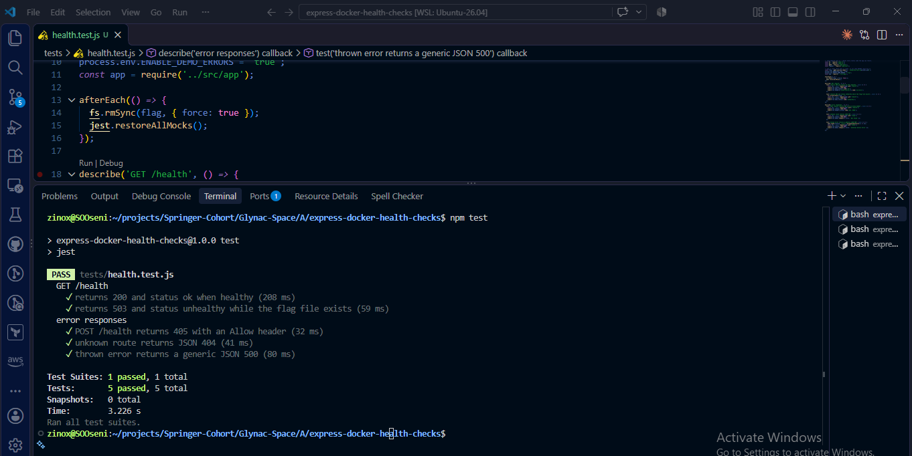
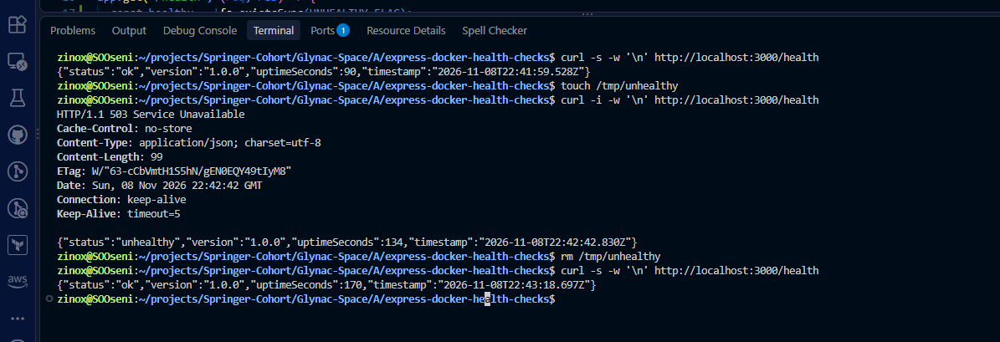
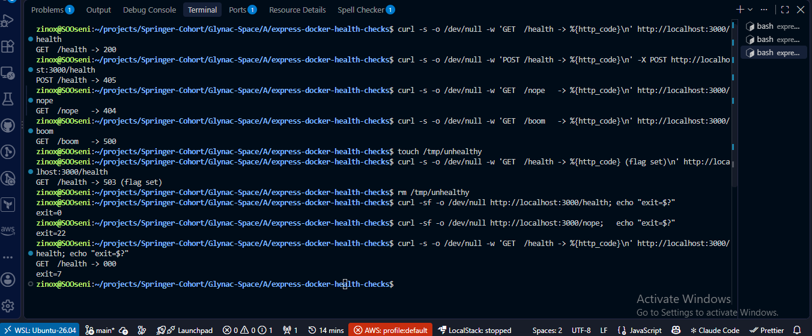
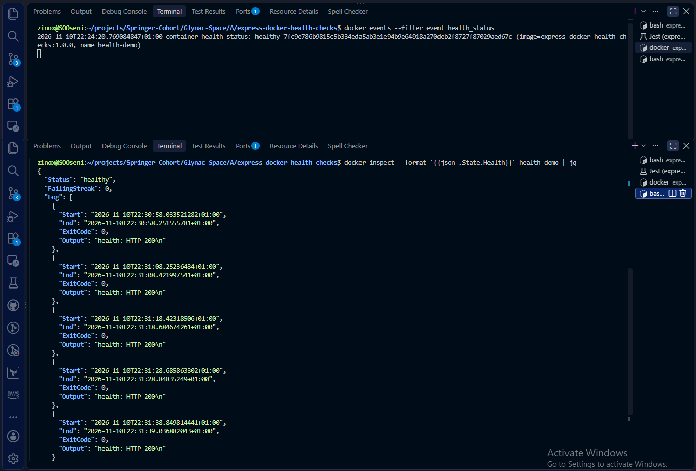
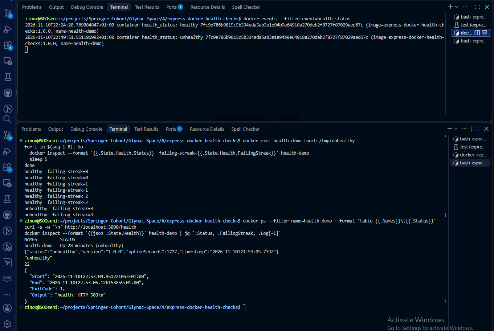
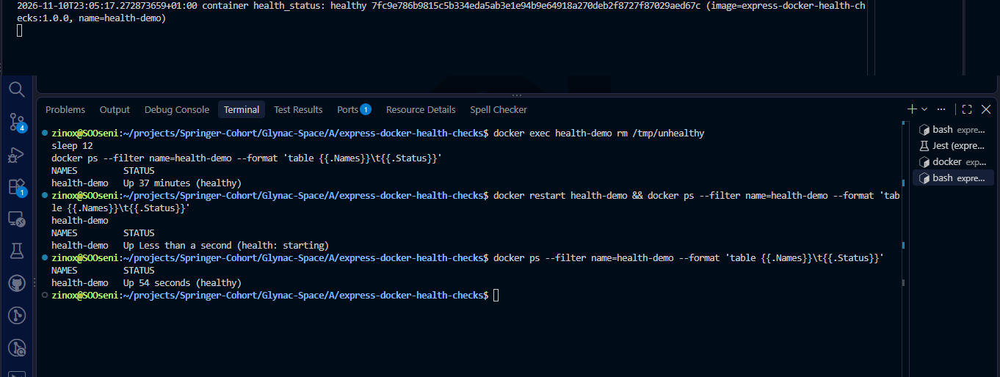

# Testing and verification results

All results come from real runs between 8 and 10 November 2026 on Ubuntu 26.04 (WSL2), Node.js 24.22.1, Express 5.3.0, Jest 30.5.2, Supertest 7.3.2 and Docker Engine 29.9.2.

## 1. Automated tests (Jest + Supertest)

`npm test` on 9 November 2026: **5 passed, 5 total**, exit code 0.

| Test | What it proves |
|---|---|
| returns 200 and status ok when healthy | the healthy path works and sends `Cache-Control: no-store` |
| returns 503 and status unhealthy while the flag file exists | the failure path is reachable and reported |
| POST /health returns 405 with an Allow header | a wrong method is refused, and the client is told which methods work |
| unknown route returns JSON 404 | the catch-all answers in JSON, not Express's HTML page |
| thrown error returns a generic JSON 500 | crashes never leak stack traces to the client |

The 503 test uses its own flag file path per run, so it never touches `/tmp/unhealthy` or a running container.

## 2. Status-code lab (curl)

| Request | Status | Meaning |
|---|---|---|
| `GET /health` | 200 | healthy |
| `POST /health` | 405 | method not allowed, `Allow: GET, HEAD` |
| `GET /nope` | 404 | no such route |
| `GET /boom` (only with `ENABLE_DEMO_ERRORS=true`) | 500 | the code threw; the stack trace stays in the server log |
| `GET /health` while `/tmp/unhealthy` exists | 503 | the app is up but cannot serve |
| `GET /health` with the app stopped | 000 | no HTTP response at all |

With `curl -f`, a 200 exits 0 and a 404 exits 22. With the app stopped, curl prints `000` and exits 7 (could not connect). Automation reads these exit codes, not the JSON.

## 3. Health probe (`src/healthcheck.js`)

| Situation | Probe output | Exit code |
|---|---|---|
| healthy | `health: HTTP 200` | 0 |
| flag file present | `health: HTTP 503` | 1 |
| app stopped | `health: connect ECONNREFUSED 127.0.0.1:3000` | 1 |

The `node:24.22.1-alpine3.23` image has no curl (`which curl` exits 1), so the probe uses the Node runtime that is already in the image.

## 4. Docker image

- `express-docker-health-checks:1.0.0`: 252 MB on disk, 63.6 MB compressed.
- `/app` holds only `node_modules`, `package.json`, `package-lock.json` and `src`, so `.dockerignore` kept tests, docs, `.git` and `.env` files out.
- 0 Jest packages in the image (`npm ci --omit=dev`).
- Stored health check: interval 10 s, timeout 3 s, start period 10 s, start interval 2 s, retries 3.

## 5. Container health timeline (10 November 2026, UTC+1)

| Time | Action | Docker health status |
|---|---|---|
| 22:24:18 | `docker run` | starting |
| 22:24:20 | first probe passes | **healthy**, 2.7 s after start |
| 22:49 | `docker exec health-demo touch /tmp/unhealthy` | healthy, failing streak 1, then 2 |
| 22:49:51 | third failure in a row | **unhealthy**, but the container keeps running |
| 22:53:05 | latest probe log entry | exit code 1, `health: HTTP 503`, failing streak 22 |
| 23:01:36 | `docker exec health-demo rm /tmp/unhealthy` | **healthy** after one passing probe |
| 23:05 | `docker restart health-demo` | starting, then healthy at 23:05:17 |
| after 23:05 | `docker stop health-demo` | SIGTERM handled, `Exited (0)` |

Docker only labels the container. It does not restart or remove an unhealthy one, so acting on the label is the job of an orchestrator or a load balancer.

